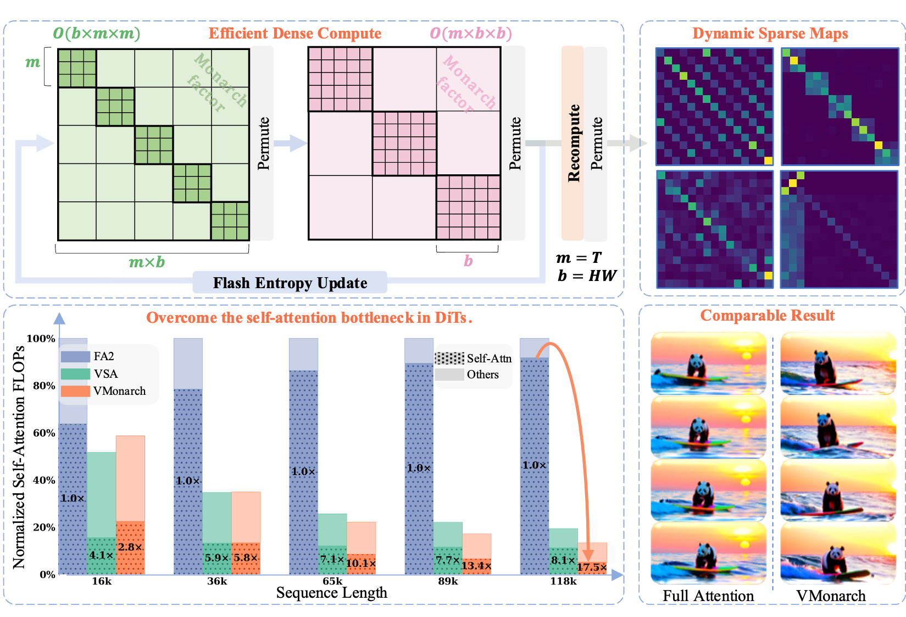
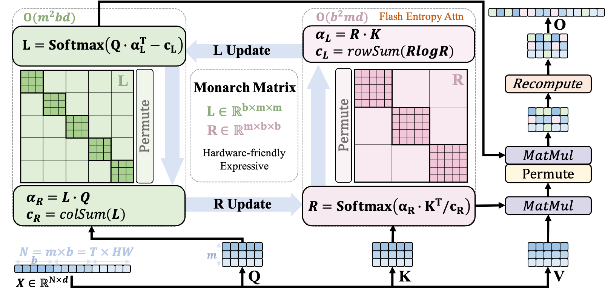
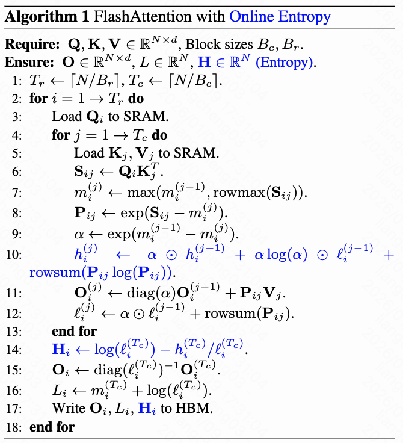

<p align="center">
  <h1 align="center">VMonarch: Efficient Video Diffusion Transformers with Structured Attention</h1>
  <p align="center">
    <a href="https://ericlina.github.io/"><strong>Cheng Liang</strong></a><sup>1,2*</sup>
    ·
    <strong>Haoxian Chen</strong><sup>1</sup>
    ·
    <strong>Liang Hou</strong><sup>2</sup>
    ·
    <strong>Qi Fan</strong><sup>1</sup>
    ·
    <strong>Gangshan Wu</strong><sup>1</sup>
    ·
    <strong>Xin Tao</strong><sup>2</sup>
    ·
    <strong>Limin Wang</strong><sup>1†</sup>
    <br />
    <sup>1</sup>Nanjing University &nbsp; <sup>2</sup>Kling Team, Kuaishou Technology
    <br />
    <small>*Work is done during internship at Kling Team, Kuaishou Technology.</small>
    <small>†Corresponding author.</small>
  </p>
  <p align="center">
    <a href='https://arxiv.org/abs/2601.22275'>
      
    </a>
  </p>
</p>

## 🚀 TL;DR

We propose **VMonarch**, a novel attention mechanism that overcomes the quadratic bottleneck in Video DiTs using structured matrices factorization.

- 🌟 **Structured factorization**: Exploits sparse spatio-temporal factorization on Attention map using **Monarch matrices**, enabling sub-quadratic attention via alternating minimization.
- 🔧 **Fast Kernel**: Proposes a novel **Online Entropy algorithm** fused into FlashAttention for efficient Monarch matrix updates during the forward pass.
- ⚡ **High Efficiency**: Reduces attention FLOPs by **17.5x** and achieves over **5x** speedup for long videos, surpassing SOTA sparse attention methods at 90% sparsity.
- 🖼️ **High Quality**: Introduces a **recomputation strategy** to mitigate artifacts and achieves generation quality comparable to full attention with **minimal finetuning**.


## 📜 Method Overview

<div align="center">
<table border="0">
  <tr>
    <td align="center" width="65%">
      
    </td>
    <td align="center" width="35%">
      
    </td>
  </tr>
</table>
</div>

  <strong>(Left)</strong> 
  (a) Factorizing the large Attention map (<i>N</i> &times; <i>N</i>) into block-diagonal sub-matrices <strong>L</strong> (<i>b</i> &times; <i>m</i> &times; <i>m</i>) and <strong>R</strong> (<i>m</i> &times; <i>b</i> &times; <i>b</i>) via alternating optimization; 
  (b) Recomputation on the first frame strategy for stability. 
  <strong>(Right)</strong> 
  (c) Online-Entropy algorithm integrated with FlashAttention for efficient Monarch factorization.
</p>

## 🛠️ Installation

```bash
git clone https://github.com/EricLina/VMonarch.git
cd VMonarch
pip install -e .
```

Requirements: PyTorch >= 2.7, Triton >= 3.5.1, and an NVIDIA GPU (Hopper or Blackwell recommended).

## ⚙️ Usage

`VMonarchAttention` is a drop-in replacement for self-attention on a sequence of `N = num_blocks * block_size` tokens,
e.g. `num_blocks` frames with `block_size` tokens each.
> `num_blocks` should be kept small for optimal performance.

```python
import torch
from video_monarch_attention import VMonarchAttention

attn = VMonarchAttention(num_blocks=16, block_size=256, num_iters=2)

B, H, N, D = 2, 4, 16 * 256, 128
q, k, v = (torch.randn(B, H, N, D, dtype=torch.bfloat16, device="cuda") for _ in range(3))
o = attn(q, k, v, recompute_tokens=256)  # exact attention for the first 256 query tokens (first frame)
```

The fused `FlashEntropyAttention` kernel (forward and backward) can also be used alone:

```python
from video_monarch_attention import flash_entropy_attention

o, e = flash_entropy_attention(q, k, v)  # o: (B, H, N, D), e: (B, H, N) row-wise attention entropy
```

Run the tests with `pytest tests`.

## 🔖 Citation

```bibtex
@article{liang2026vmonarch,
  title={VMonarch: Efficient Video Diffusion Transformers with Structured Attention},
  author={Liang, Cheng and Chen, Haoxian and Hou, Liang and Fan, Qi and Wu, Gangshan and Tao, Xin and Wang, Limin},
  journal={arXiv preprint arXiv:2601.22275},
  year={2026}
}
```

## 🙏 Acknowledgment

This work builds upon [MonarchAttention](https://arxiv.org/abs/2505.18698), [Fused-Attention](https://triton-lang.org/main/getting-started/tutorials/06-fused-attention.html) and [FastVideo](https://github.com/hao-ai-lab/FastVideo). Thanks for their open-source contributions.
